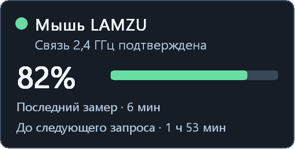
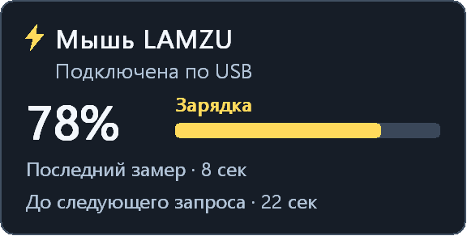
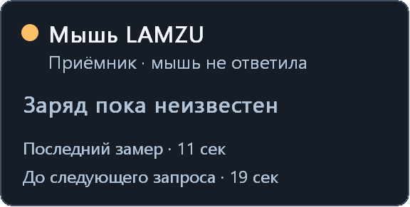

# LAMZU Battery Widget



[English version](README.md)

Виджет для мыши LAMZU работает на рабочем столе Windows 10 и 11. Он показывает статус подключения, процент заряда, время с последнего запроса и до следующего. Оба таймера показывают секунды при длительности меньше минуты. Виджет располагается за значками рабочего стола в правом верхнем углу основного монитора и пропускает щелчки.

## Дисклеймер об использовании ИИ

Код и документация подготовлены с помощью ИИ-ассистента **OpenAI Codex**.

## Демонстрационные скриншоты

Виджет отрисовал эти примеры с демонстрационными показаниями.

| Зарядка по USB | Подключение по 2,4 ГГц |
| --- | --- |
|  |  |
| **Приёмник подключён, мышь не отвечает** | **Мышь отключена** |
|  |  |

## Загрузка и использование

1. Скачайте `LAMZU-Battery-Widget-windows-x64.zip` со страницы [релизов GitHub](https://github.com/VozdyxDev/lamzu-battery-widget/releases).
2. Распакуйте ZIP и дважды щёлкните `lamzu-widget.exe`.
3. Подключите мышь кабелем или через приёмник LAMZU. Карточка появится за значками в правом верхнем углу рабочего стола.

Из папки с распакованным виджетом выполните в PowerShell `.\lamzu-widget.exe --quit`, чтобы закрыть его, или `.\lamzu-widget.exe --demo`, чтобы посмотреть пример показаний.

Если Windows сообщает об отсутствии `VCRUNTIME140.dll`, установите среду выполнения для x64. [Microsoft Visual C++ Redistributable](https://learn.microsoft.com/ru-ru/cpp/windows/latest-supported-vc-redist)

## Сборка и запуск

Нужны Rust 1.89 или новее и Visual Studio Build Tools с компонентом «Разработка классических приложений на C++».

```powershell
cargo build --workspace --release
.\target\release\lamzu-widget.exe
```

## Сборки и релизы

Каждая отправка коммитов в ветку запускает тесты и сборку для Windows x64. Workflow сохраняет `LAMZU-Battery-Widget-windows-x64.zip` как артефакт сборки. [Workflow сборки](.github/workflows/build.yml)

Отправка нового тега использует ту же сборку и публикует ZIP в релизе GitHub. Список изменений содержит коммиты с момента предыдущего опубликованного релиза. В первый релиз входит вся история, доступная от его тега. [Workflow релиза](.github/workflows/release.yml)

## Поддерживаемые устройства

Работа виджета проверена на **Maya** с кабелем (`3554:F50F`) и приёмником LAMZU Pro 1K (`3554:F50D`). Для остальных моделей совместимость зависит от USB-идентификаторов и HID-интерфейсов.

В `Config.ini` фирменной утилиты LAMZU перечислены следующие модели.

- ATLANTIS OG V2
- ATLANTIS MINI
- Thorn
- Maya
- Paro
- Atlantis Nordic-R'lyeh

## Подключение и заряд

- При наличии обоих подключений виджет проверяет заряд по кабелю.
- Виджет переводит напряжение в проценты по таблице `BatteryParam` для MAYA. Если HID-отчёт содержит только процент, виджет использует это значение.
- Windows видит USB-приёмник, даже если мышь выключена или спит. Ответ мыши подтверждает радиосвязь на момент запроса, и виджет показывает, сколько времени с него прошло.
- Виджет запрашивает заряд при запуске и при переподключении кабеля или приёмника. При проводном подключении и после неудачного запроса пауза составляет 30 секунд. После успешного запроса через приёмник пауза составляет два часа.
- Кэш в `%LOCALAPPDATA%\LamzuMonitor` сохраняет последнее значение заряда и время запроса. При потере подключения виджет скрывает значение заряда. Если приёмник остаётся подключённым, изменение состояния радиосвязи определяется при следующем запросе.

## Rust-библиотека

Крейт `lamzu-hid` использует Windows HID API. `detect_connection()` проверяет USB-подключение без передачи отчётов. `Monitor::open()` открывает кэш пользователя. Вызывайте `refresh_at_startup()` для запроса заряда при запуске приложения, `refresh()` для плановых запросов и смены устройства, а `snapshot()` для чтения уже собранных данных.

```rust
use lamzu_hid::Monitor;

fn main() -> std::io::Result<()> {
    let mut monitor = Monitor::open()?;
    let snapshot = monitor.refresh_at_startup()?;
    println!("{snapshot:?}");
    Ok(())
}
```

В приложении с интерфейсом выполняйте запросы заряда в фоновом потоке и используйте `next_sample_in()` для расчёта времени ожидания. Пример `status` проверяет, видит ли Windows поддерживаемое USB-устройство. С `--sample` он использует тот же кэш и график запросов, что и виджет.

```powershell
cargo run -p lamzu-hid --example status
cargo run -p lamzu-hid --example status -- --sample
cargo test --workspace
```

Формат запроса сверили с `HIDUsb.dll`, которая входит в фирменную утилиту LAMZU. Для чтения заряда библиотека использует 17-байтный HID-отчёт `0x08` и команду `0x04`. Если нужно установить или восстановить сеанс с приёмником, библиотека отправляет команду инициализации `0x01` в рамках того же планового запроса. [Описание протокола](https://github.com/lavandiI/lamzu-battery#compx) · [Инициализация приёмника MAYA](https://github.com/z1k1z/maya-charge/blob/main/src/main.rs#L154-L169) · [Документация Windows HID](https://learn.microsoft.com/en-us/windows-hardware/drivers/hid/sending-hid-reports)
