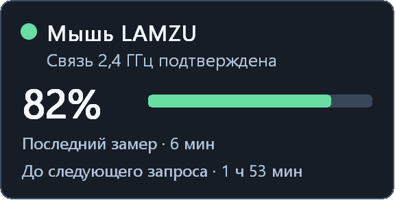
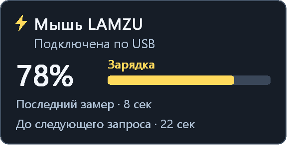

# LAMZU Battery Widget



[Русская версия](README-ru.md)

A Windows 10 and 11 desktop widget for a LAMZU mouse. It shows the connection status, battery percentage, time since the last query, and time until the next query. Both timers show seconds for durations under a minute. The widget sits behind the desktop icons in the upper-right corner of the primary display and lets mouse clicks pass through.

## AI Disclaimer

The code and documentation were created with assistance from **OpenAI Codex**, an AI coding assistant.

## Demonstration Screenshots

The widget rendered these examples with sample readings.

| Charging over USB | Connected over 2.4 GHz |
| --- | --- |
|  |  |
| **Receiver connected, mouse unavailable** | **Mouse disconnected** |
|  |  |

## Download and Use

1. Download `LAMZU-Battery-Widget-windows-x64.zip` from [GitHub Releases](https://github.com/VozdyxDev/lamzu-battery-widget/releases).
2. Extract the ZIP and double-click `lamzu-widget.exe`.
3. Connect the mouse by USB or through the LAMZU receiver. The widget appears in the upper-right corner of the desktop behind the icons.

From the extracted folder, run `.\lamzu-widget.exe --quit` in PowerShell to close the widget or `.\lamzu-widget.exe --demo` to view it with sample readings.

If Windows reports a missing `VCRUNTIME140.dll`, install the x64 runtime. [Microsoft Visual C++ Redistributable](https://learn.microsoft.com/en-us/cpp/windows/latest-supported-vc-redist)

## Build and Run

You need Rust 1.89 or later and Visual Studio Build Tools with the Desktop development with C++ workload.

```powershell
cargo build --workspace --release
.\target\release\lamzu-widget.exe
```

## Builds and Releases

Each push to a branch runs the Windows x64 tests and build. The workflow uploads `LAMZU-Battery-Widget-windows-x64.zip` as a build artifact. [Build workflow](.github/workflows/build.yml)

Pushing a new tag uses the same build to publish the ZIP in a GitHub release. The changelog lists commits since the previous published release. The first release lists the full history reachable from its tag. [Release workflow](.github/workflows/release.yml)

## Supported Devices

The widget was tested with a **Maya** over USB (`3554:F50F`) and with the LAMZU Pro 1K receiver (`3554:F50D`). Compatibility with other models depends on their USB IDs and HID interfaces.

The LAMZU utility's `Config.ini` lists these models.

- ATLANTIS OG V2
- ATLANTIS MINI
- Thorn
- Maya
- Paro
- Atlantis Nordic-R'lyeh

## Connection and Battery

- If both connections are present, the widget reads the battery over USB.
- The widget converts voltage to a percentage using the MAYA `BatteryParam` table. If the HID report provides only a percentage, it uses the reported value.
- Windows detects the USB receiver even when the mouse is off or asleep. A response from the mouse confirms the wireless link at the time of the query, and the widget shows how long ago that query occurred.
- The widget queries the battery at startup and when the cable or receiver reconnects. It waits 30 seconds between wired queries or after a failed query. After a successful wireless query, it waits two hours.
- The cache in `%LOCALAPPDATA%\LamzuMonitor` stores the last battery value and query time. The widget hides the battery value when the connection is lost. If the receiver remains plugged in, a change in the wireless link becomes apparent on the next query.

## Rust Library

The `lamzu-hid` crate uses the Windows HID API. `detect_connection()` checks for a USB connection without sending reports. `Monitor::open()` opens the per-user cache. Call `refresh_at_startup()` to query the battery when your app starts, `refresh()` for scheduled queries and device changes, or `snapshot()` to read data already collected.

```rust
use lamzu_hid::Monitor;

fn main() -> std::io::Result<()> {
    let mut monitor = Monitor::open()?;
    let snapshot = monitor.refresh_at_startup()?;
    println!("{snapshot:?}");
    Ok(())
}
```

In a GUI app, run battery queries on a background thread and use `next_sample_in()` to calculate the wait. The `status` example checks whether Windows sees a supported USB device. With `--sample`, it uses the same cache and query schedule as the widget.

```powershell
cargo run -p lamzu-hid --example status
cargo run -p lamzu-hid --example status -- --sample
cargo test --workspace
```

The query format was checked against `HIDUsb.dll`, which is bundled with the LAMZU utility. The library reads the battery with the 17-byte HID report `0x08` and command `0x04`. When it needs to start or restore a receiver session, it sends initialization command `0x01` as part of the same scheduled query. [Protocol description](https://github.com/lavandiI/lamzu-battery#compx) · [MAYA receiver initialization](https://github.com/z1k1z/maya-charge/blob/main/src/main.rs#L154-L169) · [Windows HID documentation](https://learn.microsoft.com/en-us/windows-hardware/drivers/hid/sending-hid-reports)
