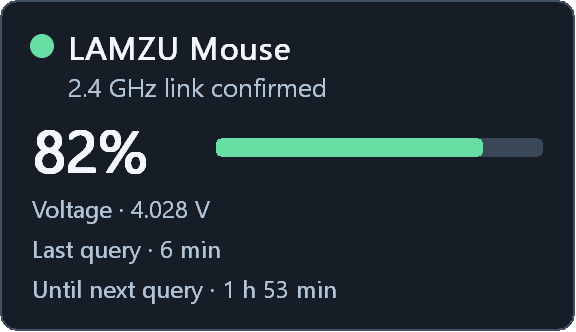
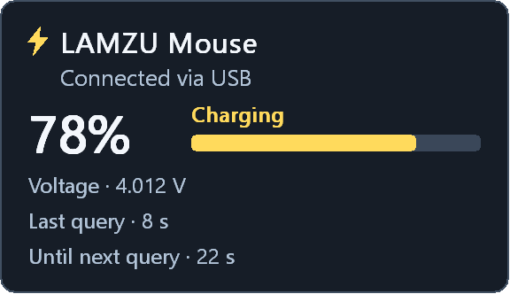
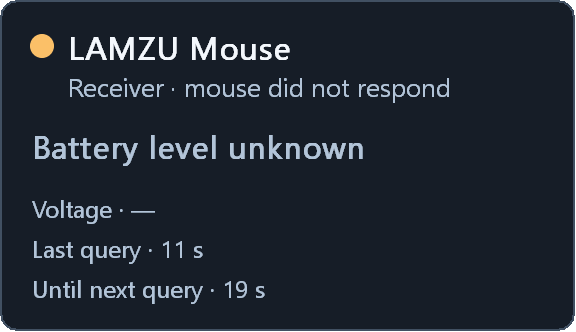
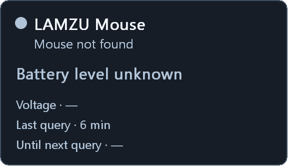

# LAMZU Battery Widget




[Русская версия](README-ru.md)

A Windows 10 and 11 desktop widget for a LAMZU mouse. It shows the connection status, battery percentage, battery voltage, time since the last query, and time until the next query. Both timers show seconds for durations under a minute. The widget sits behind the desktop icons and lets mouse clicks pass through. Its default position is the upper-right corner of the primary monitor.

## AI Disclaimer

The code and documentation were created with assistance from **OpenAI Codex**, an AI coding assistant.

## Demonstration Screenshots

The widget rendered these examples with sample readings.

| Charging over USB | Connected over 2.4 GHz |
| --- | --- |
|  |  |
| **Receiver connected, mouse unavailable** | **Mouse disconnected** |
|  |  |

## Download and Use

Download either Windows x64 package from the [GitHub Releases page](https://github.com/VozdyxDev/lamzu-battery-widget/releases).

- **Installer** (`LAMZU-Battery-Widget-windows-x64-setup.exe`). Run Setup to install the widget for your account and add a Start menu shortcut. The option to start the widget when you sign in is selected by default. You can uninstall the widget from Windows Settings.
- **Portable** (`LAMZU-Battery-Widget-windows-x64.zip`). Extract the ZIP and double-click `lamzu-widget.exe`.

Connect the mouse by USB or through the LAMZU receiver. The widget appears behind the desktop icons.

Left-click the LBW icon in the Windows notification area to hide or show the card. The widget starts with the card visible each time. Right-click the icon to change the language, toggle startup at sign-in, or close the application. Windows may place the icon among the hidden icons.

The widget checks for updates on GitHub at startup and every 24 hours. After it successfully sends a Windows notification about a newer stable release, automatic checks pause until the next launch. Click the notification to see both versions and confirm the update. Choose **Check for updates** below the version in the tray menu to check manually and open the result directly. A manual check resets the 24-hour timer while automatic checks are still active. Select **Update** to download and verify the package for your installed or portable copy. The widget restarts after the update and keeps your settings.

Use **Monitor** and **Position** in the same menu to move the card. The widget saves both settings in the Windows registry for your account. If the selected monitor disconnects, the card moves to the same corner of the primary monitor and returns when that monitor reconnects.

In **2.4 GHz polling interval**, choose 2 hours, 1 hour, 30 minutes, 10 minutes, 1 minute, or 30 seconds. **Show battery voltage** is enabled by default. Turn it off for a shorter card. Both settings are saved for your Windows account.

Run these commands in PowerShell from the extracted folder or the installation folder. Setup uses `%LOCALAPPDATA%\Programs\LAMZU Battery Widget` by default.

| Command | Result |
| --- | --- |
| `.\lamzu-widget.exe --lang EN` | Switch to English, the default, and save the choice. |
| `.\lamzu-widget.exe --lang RU` | Switch to Russian and save the choice. |
| `.\lamzu-widget.exe --autostart` or `.\lamzu-widget.exe -a` | Start this copy of the widget when you sign in to Windows. |
| `.\lamzu-widget.exe --autostart-remove` or `.\lamzu-widget.exe -arm` | Turn off startup for your account. |
| `.\lamzu-widget.exe --quit` | Close the widget. |
| `.\lamzu-widget.exe --demo` | Open the widget with sample readings after closing any running instance. |

The selected language applies immediately and is used the next time the widget starts. If you move a portable copy that starts with Windows, run `--autostart` again from its new folder.

## Build and Run

You need Rust 1.89 or later, Visual Studio Build Tools with the Desktop development with C++ workload, and the Windows SDK.

```powershell
cargo build --workspace --release
.\target\release\lamzu-widget.exe
```

## Builds and Releases

Pushes to regular branches run the Windows x64 tests and build. The workflow uploads the Inno Setup installer and portable ZIP. [Build workflow](.github/workflows/build.yml)

Creating a branch matching `release/v**` on GitHub starts the release workflow. For example, `release/v0.1.0` runs the same build, creates the `v0.1.0` tag, and publishes both packages with a changelog. The changelog lists commits since the previous published release. The first release lists the full history reachable from its tag. After publication, the workflow deletes the release branch if its tip still matches the released commit. [Release workflow](.github/workflows/release.yml)

## Supported Devices

The widget was tested with a **Maya** over USB (`3554:F50F`) and with the LAMZU Pro 1K receiver (`3554:F50D`). Compatibility with other models depends on their USB IDs and HID interfaces.

The LAMZU utility's `Config.ini` lists these models.

- ATLANTIS OG V2
- ATLANTIS MINI
- Thorn
- Maya
- Paro
- Atlantis Nordic-R'lyeh

## Connection and Battery

- If both connections are present, the widget reads the battery over USB.
- The widget converts voltage to a percentage using the MAYA `BatteryParam` table. If the HID report provides only a percentage, it uses the reported value.
- Windows detects the USB receiver even when the mouse is off or asleep. A response from the mouse confirms the wireless link at the time of the query, and the widget shows how long ago that query occurred.
- The widget queries the battery at startup and when the cable or receiver reconnects. It waits 30 seconds between wired queries or after a failed query. After a successful wireless query, it uses the selected interval, which defaults to two hours. Changing the interval recalculates the deadline from the last query.
- The cache in `%LOCALAPPDATA%\LamzuMonitor` stores the last battery reading and query time. The widget hides the battery percentage and voltage when the connection is lost. If the receiver remains plugged in, a change in the wireless link becomes apparent on the next query.

## Rust Library

The `lamzu-hid` crate uses the Windows HID API. `detect_connection()` checks for a USB connection without sending reports. `Monitor::open()` opens the per-user cache. Call `refresh_at_startup()` to query the battery when your app starts, `refresh()` for scheduled queries and device changes, or `snapshot()` to read data already collected.

```rust
use lamzu_hid::Monitor;

fn main() -> std::io::Result<()> {
    let mut monitor = Monitor::open()?;
    let snapshot = monitor.refresh_at_startup()?;
    println!("{snapshot:?}");
    Ok(())
}
```

In a GUI app, run battery queries on a background thread and use `next_sample_in()` to calculate the wait. Call `set_receiver_interval()` to change the default two-hour interval for successful wireless queries. The `status` example checks whether Windows sees a supported USB device. With `--sample`, it uses the shared cache and the library's default interval.

```powershell
cargo run -p lamzu-hid --example status
cargo run -p lamzu-hid --example status -- --sample
cargo test --workspace
```

The query format was checked against `HIDUsb.dll`, which is bundled with the LAMZU utility. The library reads the battery with the 17-byte HID report `0x08` and command `0x04`. When it needs to start or restore a receiver session, it sends initialization command `0x01` as part of the same scheduled query. [Protocol description](https://github.com/lavandiI/lamzu-battery#compx) · [MAYA receiver initialization](https://github.com/z1k1z/maya-charge/blob/main/src/main.rs#L154-L169) · [Windows HID documentation](https://learn.microsoft.com/en-us/windows-hardware/drivers/hid/sending-hid-reports)
